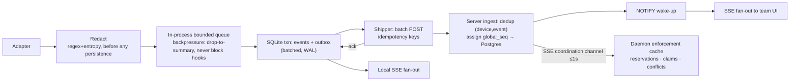

# Weft — Architecture Document

**Date:** 2026-11-07 · **Status:** Proposed; awaiting approval.

## 1. Architectural comparison (three viable approaches)

| Criterion | A. Extend existing OSS (OpenHands Canvas / Vibe Kanban) | B. Modular coordination platform around existing agents | C. From-scratch system with own agent runtime |
|---|---|---|---|
| Fit to vision | Poor: conversation-centric (OH) or single-user sunsetting (VK); ~70% of differentiator still new | **Exact: agents stay in native environments; platform observes/coordinates/verifies** | Poor: becomes another coding agent — explicitly not the product |
| Performance | Inherits upstream choices; VK Rust fast but wrong shape | Event-driven, incremental, minimal overhead; own the hot paths | Full control but must rebuild sandboxing/harness — enormous scope |
| Reliability | Upstream-dependent; VK company dead; OH healthy but pivoting | Own the coordination core; per-adapter fidelity degradation | Own everything, including agent execution reliability |
| Complexity | Fight foreign abstractions; fork drift | Moderate; every subsystem maps to a requirement | Highest: agent harness + sandbox + coordination + verification |
| Extensibility | Upstream plugin models, wrong core shape | Adapter packages + versioned event protocol | Maximal but unnecessary |
| Security | Inherits upstream model | Metadata-only default, redaction at ingest, own trust boundaries | Must build agent sandboxing from zero |
| Ops cost | Low–medium | **Low: one server process + Postgres; daemon per dev** | High: runner fleet, sandboxes |
| Dev effort | Fast demo, slow product | Core effort IS the product | 3–5× scope for features nobody asked for |
| Verdict | **Reject as foundation; lift components** (VK executors Apache-2.0, OH event model, ACP) | **SELECT** | **Reject** (revisit "launched sessions" as P2 via SDK adapters) |

Decision rationale: the research ([01](01-research-report.md) §8) shows the differentiators — cross-developer coordination, symbol-level conflicts, independent validation, failure attribution — exist in no product, so forking shortcuts nothing. Approach B is the simplest architecture that delivers them.

## 2. Selected architecture: local-first modular monolith, two deployments

One TypeScript/Node codebase, two deployment shapes:

- **`weft daemon`** — per developer machine (Win/macOS/Linux). Owns everything that needs the code: collection, redaction, indexing, worktrees, validation execution, MCP coordination, local UI. Fully functional offline (solo mode).
- **`weft server`** — per team, self-hosted. Owns shared state: tasks, team stream, conflict aggregation, merge queue, health baselines, RBAC/audit. One process + Postgres. Never requires source code by default.

Git hosting stays external (GitHub/GitLab/Gitea/any origin). Daemons push task/WIP branches to origin; the server coordinates refs and metadata, not blobs.

```mermaid
flowchart LR
  subgraph DevMachine["Developer machine (×N)"]
    Agent["Coding agent<br/>(Claude Code / Codex / OpenCode / Cursor / Qoder / CLI)"]
    Hooks["Native hooks / SSE / stream-json"]
    Daemon["weft daemon<br/>collector · redaction · SQLite WAL · outbox<br/>watcher · indexer · worktree mgr · validator<br/>MCP coordination server · local UI (SSE)"]
    WT["git worktrees<br/>(task branches, auto-WIP)"]
    Agent <-->|stdio/HTTP MCP: tasks, context, locks| Daemon
    Agent --> Hooks --> Daemon
    Daemon --> WT
  end
  Origin["Git origin<br/>(GitHub / GitLab / self-hosted)"]
  subgraph TeamServer["Team server (×1, self-hosted)"]
    Server["weft server<br/>ingest (dedup) · task state · conflict engine<br/>merge queue · health baseline · attribution<br/>SSE fan-out · team UI · RBAC/audit"]
    PG[("Postgres<br/>events (monthly partitions)<br/>state · symbols metadata · audit")]
    Server --- PG
  end
  Daemon -->|HTTPS batched outbox<br/>metadata-only default| Server
  Server -->|SSE (Last-Event-ID resume)| Browser["Team UI (browser)"]
  Daemon -->|SSE| LocalUI["Local UI (browser)"]
  Daemon -->|push task/WIP branches| Origin
  Server -->|fetch refs (metadata mode: refs only)| Origin
```

### 2.1 Privacy modes

| Mode | What leaves the machine | Conflict analysis runs | Use case |
|---|---|---|---|
| Solo | Nothing | Daemon | Individual, offline |
| Team **metadata-only** (default) | Events (redacted), task ops, symbol signatures/edges, file paths+hashes, validation results | Daemons (pairwise merge-tree against origin branches); server aggregates/dedups | Privacy-sensitive teams |
| Team **full** (opt-in, self-hosted trust) | + diffs, source blobs on demand | Server bare mirror runs merge-tree centrally; server-side runners possible | Teams wanting central analysis |

## 3. Subsystem architecture

### 3.1 Collection (daemon)
- **Hook receiver**: localhost HTTP endpoint accepting Claude-shaped hook JSON (Claude Code, Codex, Qoder, Cursor adapters normalize provider deltas). `async` hooks → fire-and-forget; latency budget ≤5ms p50.
- **SSE client**: OpenCode `/event` subscription (durable envelope with seq).
- **Stream-json/stdio adapters**: for launched sessions (P2) and CLI wrappers.
- **Fallback collector**: @parcel/watcher hints + `git status` reconciliation (truth) + PTY wrapper for generic CLIs; Aider via history files + auto-commits.
- Every adapter emits **protocol v1 events** ([06](06-event-protocol.md)); adapter capability manifest declares fidelity so the UI can show "partial telemetry" honestly.

### 3.2 Event pipeline (daemon → server)

- At-least-once delivery; effectively-once ingest via `(device_id, event_id)` unique constraint.
- Ordering: per-session `seq` (client) + project `global_seq` (server). Consumers needing causality use session seq; the team stream orders by global_seq.
- Offline: outbox grows on disk (bounded, oldest telemetry compacted to summaries first — task ops and validation evidence are never dropped); cursor catch-up on reconnect.
- Backpressure: hooks never block on the network; queue overflow coalesces file events into summaries (lossy telemetry is labeled; lossless for task/validation/commit events).
- **Server→daemon channel:** daemons hold a device-authenticated SSE subscription to the project's coordination events (`task.*`, `reservation.*`, `conflict.*`, `merge.*`), same resume protocol as the UI. Propagation SLO ≤1s p95. This keeps enforcement copies (reservations, claims) fresh. **Hard reservations fail closed when the copy is stale** (subscription down beyond grace → PreToolUse denies hard-reserved edits with a "coordination offline" reason); soft reservations fail open. Reconnect reuses cursor catch-up.
- **Two hook classes:** *telemetry* hooks are async fire-and-forget (never block the agent); *enforcement* hooks (PreToolUse reservation checks) are synchronous by necessity, budgeted p99 ≤50ms local, with the fail-closed/fail-open policy above. The "hooks never block" rule applies to telemetry only.

### 3.3 Task coordination (server-authoritative, daemon-cached)
- Task state is **event-sourced with snapshots**: `task_events` fold deterministically to the current snapshot; every mutation carries its base version; the server applies CAS. Field edits merge **field-level** (disjoint fields commute); same-field edits at the same base version raise an explicit `edit_conflict` for human resolution — never silent field loss.
- Claims are atomic server CAS → no double-claim. **Offline claims are provisional**: the daemon may prepare a *quarantined* worktree (no agent assignment, no reservations), but agent work starts only on server ack. A losing claim receives `task.claim_rejected`; the daemon discards the untouched quarantine, notifies the developer, and re-syncs. Two offline devs claiming one task: first durable CAS wins, second is rejected — deterministic, no split-brain.
- Dependencies: DAG; READY computed from dependency completion; cycle detection on write. Discussion: append-only `task.commented` events (human or agent, provenance-labeled); handoffs are `task.handed_off` events carrying a deterministic context bundle.
- Context delivery to agents: MCP tools (`get_task`, `claim_task`, `report_progress`, `get_concurrent_changes`, `reserve_files`) + Claude channels push. Context is **deterministic, ranked, budgeted** (≤2KB default): own task, reservations overlapping expected files, recent signature changes in dependencies — never a raw event dump, never an LLM call by default. Agent-authored free text entering any context is wrapped as explicitly untrusted data (provenance + "data, not instructions" framing).

### 3.4 Git coordination (daemon-executed, server-coordinated)
- Worktree per task off the shared clone; `git worktree lock` for agent worktrees; stale `.lock` detection/recovery; serialize shared-ref ops per repo (mutex); one writer per branch enforced. Provisioning is gated on server claim-ack (offline claims get a quarantined worktree, §3.3).
- Auto-WIP: commit dirty state to `refs/wip/<task>/<device>` on timer (30s dirty) and before dangerous ops — **device-namespaced** so multi-device work on one task never collides; invisible to normal branch lists; recoverable via reflog. Pushing WIP refs to origin is project-opt-in (privacy modes apply); divergence keeps both device histories (never force); pruning belongs to the queue-executor daemon after task completion + grace.
- Conflict engine (two tiers):
  - **Textual**: `git merge-tree --write-tree` task branch vs integration base → clean/conflict gate.
  - **Semantic overlap**: diff line ranges → enclosing symbols (tree-sitter, branch-scoped index §3.5) → intersect across active tasks → "both modified `foo()`" warnings even when merge is clean; signature-change → call-site impact (L2).
- **Merge queue execution (works in every privacy mode):** the server coordinates queue state but never needs blobs. A **queue-executor daemon** holds a server-granted fenced lease (one per repo, renewable) and performs: fetch task branches from origin → merge-tree chain (batch disjoint footprints) → `commit-tree` → dispatch exact-tree validation to a device ≠ the claimant (§3.6) → push the integration commit to origin **with an old-OID precondition** (`--force-with-lease=<ref>:<expected-old>` — a compare-and-swap that *fails rather than overwrites*; the only sanctioned lease use, not a force) → server records the advance in the audit log. Origin rejection (ref moved) → re-fetch and rebuild; never overwrite. Executor crash mid-advance: lease expires, successor re-reads origin truth; the CAS push makes partial execution safe.
- **Protected integration branches:** direct push may be forbidden. Per-project strategy chosen at setup by capability detection: (a) final advance via the host's merge API (GitHub/GitLab PR merge), queue gating unchanged; or (b) unprotected `weft/integration` ref + explicit promotion PR. The queue never bypasses branch protection.
- Never discard uncommitted work; never silently merge unvalidated trees.

### 3.5 Code intelligence (daemon)
- tree-sitter symbol index in SQLite keyed by **(repo, tree_oid, path, qualified_name)** + content hash — **branch-scoped**: different task branches' indexes never overwrite each other. The branch-owner daemon is authoritative for uploading that branch's exported-symbol metadata; the server keeps per-ref versions and resolves impact queries against the querying task's own ref. **Git diff drives invalidation** (watcher events are hints); fresh parse per changed file (research: full parses are ms-cheap; incremental parsing is an editor concern).
- L1: exports + normalized signatures. L2: TS Compiler API `findAllReferences` in a **separate resolver process** — typed ASTs ≈30× source size cannot live inside the daemon's 300MB budget: one program per repo, own budget (≤1GB configurable), idle eviction after 10 min, restart on demand; never per worktree. Module graph via dependency-cruiser; other languages via per-language LSP (P2). Resolver memory at 10k/100k files is an M3 exit benchmark.
- Uploads symbol metadata (names, signatures, edges, ref) in team mode; source stays local.

### 3.6 Independent validation (daemon-executed, server-recorded)
- Triggers: task → VALIDATION; merge-queue gating; manual.
- **Independence threat model:** validation is independent of the *agent*; in team mode, queue-gating runs execute on a **device ≠ the claimant** (the executor dispatches to any online daemon with a compatible toolchain fingerprint; server runners P2). Solo mode is explicitly labeled "self-validation". Same-user local forgery is a documented residual risk in solo mode only — cross-device execution is the team-mode guarantee.
- Runs configured checks (typecheck/lint/unit/integration/build/contract/migration/security) as child processes in a **dedicated validation worktree** at the exact candidate tree; timeouts, semaphore (≈cores−1), scrubbed env, output capped + redacted.
- Evidence: exit code, duration, log digest, artifact paths, check identity + input hash → hash-keyed result cache. **Cache correctness:** `input_hash` = tree + check config + toolchain fingerprint (lockfile hash + runtime versions + OS/arch); hits require compatible fingerprints; TTL 7 days; **flake quarantine** — a failure after a cached pass invalidates the entry and excludes the check from caching until N consecutive passes.
- TIA: Jest `--findRelatedTests` / affected selection where configured; periodic full-suite baseline run as safety net.
- Server maintains **health baseline** per integration branch; regression = new failure vs baseline → attribution engine ranks changes-since-healthy by file/symbol overlap with the failure, marks confirmed (reproduced by revert-test) vs suspected.

### 3.7 Failure attribution and recovery
- Inputs: health transitions, validation evidence, commit/session/task linkage, symbol overlap.
- Output: "build broke at T; changes X,Y,Z landed since last healthy; X (agent A, task T-123) touches the failing module — suspected; revert-test confirms" → safe recovery = revert the offending merge commit on the integration branch (never reset/force; other work preserved).

### 3.8 Security architecture
- Trust boundaries: agent-origin content (prompts, tool output, diffs) is **untrusted data** — rendered as text, never executed, never fed back to agents as instructions without provenance labels (prompt-injection containment).
- Redaction before persistence/broadcast; secrets never synced; salted hashes for dedup.
- Daemon: localhost binding by default, token auth (OS keychain), explicit opt-in for LAN. **Hook receiver auth:** per-device rotatable bearer secret in user-level hook config; preferred where available, local IPC with peer-credential checks (Unix socket creds / named-pipe ACLs). Same-user read access to the secret is a documented residual risk; team-mode evidence weight comes from cross-device validation, not local secrecy.
- Server: project-scoped API tokens, RBAC (viewer/member/admin), `project_id` predicate on every query, append-only audit, TLS.
- Command execution: only project-configured check commands + agent commands already running on the dev machine; server never executes arbitrary remote commands in v1 (runner registration is explicit, scoped, audited).

## 4. Data flow summary

```mermaid
sequenceDiagram
  participant Ag as Agent (Claude Code)
  participant D as Daemon (claimant)
  participant S as Server
  participant X as Queue-executor daemon
  participant O as Git origin
  participant UI as Team UI
  Ag->>D: PostToolUse hook (http, async)
  D->>D: redact → SQLite(events+outbox) → local SSE
  D->>S: POST /ingest batch (idempotent)
  S->>S: dedup → global_seq → Postgres → NOTIFY
  S-->>UI: SSE batch (50ms flush)
  S-->>D: SSE coordination channel (reservations/claims ≤1s)
  Ag->>D: MCP claim_task(T-123)
  D->>S: task.claimed (CAS version)
  S-->>D: ack (worktree provisioning gated on this)
  S-->>UI: task state delta
  D->>D: worktree add + auto-WIP armed
  Ag->>D: Stop hook (completion claim)
  D->>S: task.completion_claimed (unverified)
  D->>D: validation worktree → checks → evidence
  D->>S: validation.completed (passed)
  S->>X: queue lease granted (fenced, one per repo)
  X->>O: fetch task branches
  X->>X: merge-tree chain → commit-tree (speculative)
  X->>X: dispatch exact-tree validation (device ≠ claimant)
  X->>O: push integration commit (old-OID precondition; fail-on-moved)
  X->>S: advance recorded (audit) → task.completed (verified)
  S-->>UI: verified completion + evidence
```

## 5. Deployment

| Shape | Components | Requirements |
|---|---|---|
| Solo | daemon + browser | Node LTS, git ≥2.38 |
| Team (default) | daemon ×N + server + Postgres + existing git origin | Linux server recommended; Docker optional (server validators, P2) |
| Team full | + server bare mirror | Server disk for mirror; explicit opt-in |

Distribution: npm (`npx weft` / global install) for daemon; Docker image + bare Node for server. No Kubernetes, no message brokers, no object storage required (Litestream/Parquet archive optional later).

## 6. What this architecture deliberately excludes

Kafka/Redis/NATS (scale unjustified), CRDTs (no concurrent rich-text), WebTransport (no resume benefit), microservices (one team-scale domain), graph database (SQLite relational edges suffice at this scale), full event sourcing of telemetry, Docker on dev machines, LLM calls in the hot path, Monaco in the initial bundle. Each exclusion is revisitable only with a measured requirement.