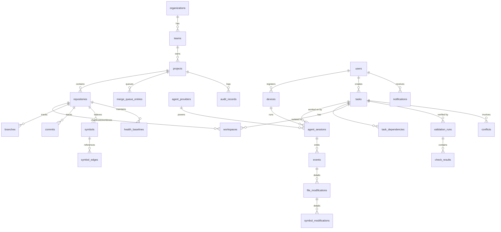

# Weft — Data Model

**Date:** 2026-11-07 · Conventions: ULID primary keys (`prefix_…`), `timestamptz` UTC, snake_case. **L** = daemon-local (SQLite), **C** = server-central (Postgres), **L→C** = created locally, synced via outbox (metadata-only unless configured).

## 1. Entity relationship overview

## 2. Identity and topology

| Entity | Fields (beyond id/timestamps) | Locality | Notes |
|---|---|---|---|
| organizations | name, slug | C | Self-hosted: usually one |
| teams | org_id, name, slug | C | |
| users | org_id, email, display_name, role_global | C | Auth via OIDC or local accounts (P1); solo mode: single local user |
| memberships | user_id, team_id, role | C | team roles: viewer/member/admin |
| project_members | project_id, user_id, role | C | project-scoped RBAC predicate |
| projects | team_id, name, slug, settings(jsonb: sync_scope, retention_days, validation_policy) | C | `sync_scope`: metadata \| diffs \| full |
| repositories | project_id, name, origin_url, default_branch, local_path_hint | C (metadata) | Origin credentials never stored server-side in metadata mode |
| devices | user_id, hostname, os, pubkey, last_seen, daemon_version | L→C | Device keypair signs ingest batches |
| api_tokens | user_id/device_id, project_id, scope[], hash, expires_at | C | Hashed only; audit on use |
| agent_providers | name, adapter_version, capability_manifest(jsonb) | C (registry) | Declares fidelity: which event types the adapter can emit |

## 3. Execution and activity

| Entity | Fields | Locality | Notes |
|---|---|---|---|
| workspaces | repo_id, task_id?, device_id, kind(checkout\|worktree), path, branch, head_oid, state(active\|stale\|removed), locked | L→C (metadata) | Path is device-local; server stores mapping only |
| agent_sessions | device_id, provider_id, provider_session_id, task_id?, developer_id, cwd/workspace_id, status(running\|idle\|completed\|failed\|interrupted), started_at, ended_at, model, prompt_summary (redacted, ≤400 chars), fidelity(high\|medium\|low) | L→C | `(device_id, provider_session_id)` unique |
| events | device_id, event_id(ULID), project_id, repo_id?, session_id?, task_id?, seq(per session), global_seq(server-assigned), ts(client), received_at(server), type, actor(jsonb), payload(jsonb), schema_version, privacy(metadata\|full) | L→C | Append-only telemetry. Server: monthly range partitions on **received_at** (late offline arrivals never hit dropped partitions); dedup unique `(device_id, event_id, received_at)` + replay-safe upsert (client ts immutable); index `(project_id, global_seq)`. Stream exposes `min_seq` watermark; cursor < watermark → forced resync, never silent skip |
| coordination_events | same envelope | L→C | **Never-expiring** table for task.*, reservation.*, conflict.*, merge.*, validation.*, commit.created — outside telemetry retention; the durable coordination audit trail |
| file_modifications | event_id, repo_id, session_id, task_id?, path, change_kind(add\|modify\|delete\|rename), old_hash?, new_hash?, lines_added, lines_removed, symbols_touched | L→C | Derived from file.changed events; no content in metadata mode |
| symbol_modifications | file_modification_id, repo_id, symbol_id?, name, kind(function\|class\|method\|type\|interface\|const), change_kind(added\|removed\|signature\|body), old_signature?, new_signature? | L→C | Signatures are normalized (name, params, types, return) |
| commits | repo_id, oid, branch_ids[], author_user_id?, session_id?, task_id?, parents[], message_summary, ts | L→C | Linked to session via commit hook/ trailer `Weft-Task: T-123` |
| branches | repo_id, name, head_oid, task_id?, kind(task\|integration\|wip\|main), protected | L→C | WIP refs tracked but hidden from default lists |

## 4. Coordination

| Entity | Fields | Locality | Notes |
|---|---|---|---|
| tasks | project_id, repo_id?, number, title, description, acceptance_criteria(jsonb[]), validation_requirements(jsonb: required check ids, default=project policy), priority(P0–P3), state, expected_modules[], expected_files[], branch?, workspace_id?, version(CAS), created_by, parent_task_id?, edit_conflict(jsonb?) | C (authoritative), L cache | State = deterministic fold of task_events → snapshot; version increments per mutation; same-field concurrent edits raise edit_conflict (no silent loss) |
| task_assignees | task_id, user_id?, agent_provider?, role(primary\|collaborator) | C | Multi-assignee (spec: humans, single or multiple agents); exactly one primary |
| task_comments | task_id, author(user\|agent+provenance), body(redacted), handoff_bundle(jsonb?), ts | C | Append-only discussion + handoffs; agent text labeled untrusted |
| task_dependencies | task_id, depends_on_task_id | C | DAG; cycle check on write; READY = all deps COMPLETED |
| task_events | task_id, version, type, actor, payload | C | Event-sourced task state; the audit trail for coordination |
| file_reservations | repo_id, task_id, session_id, path_glob, mode(soft\|hard), expires_at, renewed_at, grace_until, state | C (authoritative), L enforcement copy | Hard mode → PreToolUse blocks **only where the adapter manifest supports sync enforcement** (else auto-downgrade to soft, labeled); holder renewal heartbeat + expiry grace + holder notification; stale enforcement copy → hard fails closed |
| conflicts | **server-assigned id**, canonical_key(unique: kind + sorted task_ids + normalized paths/symbols), repo_id, kind(textual\|file_overlap\|symbol_overlap\|signature_impact\|contract\|schema), task_ids[], branch_a, branch_b, paths[], symbol_ids[], evidence(jsonb[] append-only: merge-tree output, diff ranges, detecting device), detection_epoch, severity(info\|warning\|blocking), state(open\|resolved\|dismissed), resolved_by? | L→C | Daemons detect pairwise and submit the canonical key; **server mints the id** on first ingest and unions evidence; resolution restricted to task owners/admins; re-detection in a later epoch reopens with linked history (no flapping) |
| merge_queue_entries | project_id, repo_id, task_id, position, state(queued\|testing\|merged\|ejected), speculative_tree_oid?, base_oid, validation_run_id?, ejected_reason?, **executor_device_id, lease_epoch(fenced), push_precondition_oid** | C | Advance = origin push with old-OID precondition by the lease-holding executor; server records audit; protected branches use host merge API or promotion PR (never bypass) |

## 5. Intelligence

| Entity | Fields | Locality | Notes |
|---|---|---|---|
| symbols | repo_id, **tree_oid** (branch-scoped), file_path, name, qualified_name, kind, signature_normalized, exported, start_line, end_line, content_hash, body_hash, owner_device_id | L; L→C metadata (exported only, default) | Keyed by **(repo, tree_oid, path, qualified_name)** — different branches never overwrite; branch-owner daemon authoritative for uploads; invalidated by content_hash change |
| symbol_edges | repo_id, **tree_oid**, from_symbol_id, to_symbol_name, to_file_hint?, kind(calls\|imports\|references\|type_ref), precision(exact\|name_based), resolver(compiler_api\|lsp\|tree_sitter), source_hash | L; L→C for exported targets | Same branch scope as symbols; name-based edges labeled; exact edges from the out-of-process resolver |
| api_contracts | repo_id, kind(openapi\|protobuf\|graphql\|db_schema), path, version_hash, breaking_ruleset | L→C (metadata) | Gates via oasdiff/buf/squawk/prisma |
| health_baselines | repo_id, branch, commit_oid, state(healthy\|unhealthy), check_results_summary(jsonb), established_at | C | Baseline advances only on full-suite pass |
| regressions | repo_id, baseline_id, failure_fingerprint, first_seen, suspected_changes(jsonb: commit/session/task + overlap score), confirmed_change_id?, state(open\|attributed\|recovered) | C | Attribution evidence links |

## 6. Verification

| Entity | Fields | Locality | Notes |
|---|---|---|---|
| validation_runs | repo_id, task_id?, trigger(task\|queue\|manual\|baseline), candidate_oid, tree_oid?, runner_device_id?, **claimant_device_id?** (queue runs: runner ≠ claimant), state(running\|passed\|failed\|error\|cancelled), started_at, finished_at, input_hash, **toolchain_fingerprint**(lockfile hash+runtimes+OS/arch), cache_hit, **cache_expires_at**, independence(self\|cross_device\|server) | L→C | Cache hits require compatible fingerprints; TTL 7d; flake quarantine (fail-after-cached-pass invalidates + excludes until N passes) |
| check_results | validation_run_id, check_id(typecheck\|lint\|unit\|integration\|build\|contract\|migration\|security), command_display(redacted), exit_code, duration_ms, log_digest, log_excerpt(redacted, capped), artifacts[], selection(full\|affected), newly_failing(bool vs baseline) | L→C | Evidence is inspectable; logs capped (default 64KB/check) |
| completion_claims | task_id, session_id, claimed_at, claim_text(redacted), evidence_state(unverified\|pending\|passed\|failed\|human_required) | L→C | Agent-reported completion is a claim, never a state transition to COMPLETED by itself |

## 7. UX and governance

| Entity | Fields | Locality | Notes |
|---|---|---|---|
| notifications | user_id, project_id, kind(approval\|question\|failure\|conflict\|mention), subject_type/id, state(inbox\|saved\|done), created_at | C | Inbox/Saved/Done triage model |
| audit_records | project_id, actor(user\|device\|system), action, subject, before/after hashes, ts | C | Append-only; auth, RBAC, queue, reservation, token events |
| event_summaries | project_id, session_id?, window_start/end, group_key(actor+module+window), template_id, params(jsonb), event_ids[] | L→C | Deterministic grouping ("8 files in auth"); expandable to evidence |

## 8. Locality and sync rules

1. **Source code, full diffs, raw logs**: local only, unless project `sync_scope` opts in (`diffs`/`full`).
2. **Synced by default (metadata)**: redacted events, task ops, session records, file paths+hashes+line counts, exported symbol signatures/edges, validation evidence (exit codes, durations, digests, capped redacted excerpts), conflicts, branch/commit metadata.
3. **Server-authoritative**: tasks, reservations, merge queue, RBAC, audit, health baselines. Daemon caches with version cursors; offline writes queue in outbox (task claims provisional until ack).
4. **Daemon-authoritative**: worktrees, symbol index, validation execution, watcher state. Server stores metadata mirrors only.
5. **Retention**: telemetry events partitioned monthly on **received_at**, default 90 days hot (configurable); **coordination_events (task/reservation/conflict/merge/validation/commit) never expire by default**; task/validation/audit records retained indefinitely; WIP refs (`refs/wip/<task>/<device>`) pruned by the executor daemon after completion + grace (7 days); outbox compaction drops oldest *telemetry* first, never coordination events (overflow segment is capped with explicit backpressure, not unbounded).
6. **Stream resume**: server exposes `min_seq` watermark per project; a cursor below it triggers full resync of current state + retained history, never a silent skip.

## 9. Indexing plan (hot queries)

| Query | Index |
|---|---|
| Team stream catch-up / SSE resume | events `(project_id, global_seq)` |
| Session timeline | events `(session_id, seq)` |
| Task lookup / filters | tasks `(project_id, state, priority)`; task_dependencies `(depends_on_task_id)` |
| Overlap detection | file_modifications `(repo_id, task_id, path)`; symbol_modifications `(repo_id, name)` |
| Impact analysis | symbol_edges `(repo_id, tree_oid, to_symbol_name)`; symbols `(repo_id, tree_oid, content_hash)` |
| Dedup ingest | events unique `(device_id, event_id, received_at)` (partition-key-safe) + upsert |
| Conflict dedup | conflicts unique `(canonical_key)`; evidence append-only |
| Attribution | commits `(repo_id, ts)`; check_results `(validation_run_id, newly_failing)` |
| Cache lookup | validation_runs `(repo_id, input_hash)` where state=passed |

All list endpoints keyset-paginated (no OFFSET); no N+1 (batched loaders); payload JSONB kept small — large logs/artifacts stay local with content-addressed references.